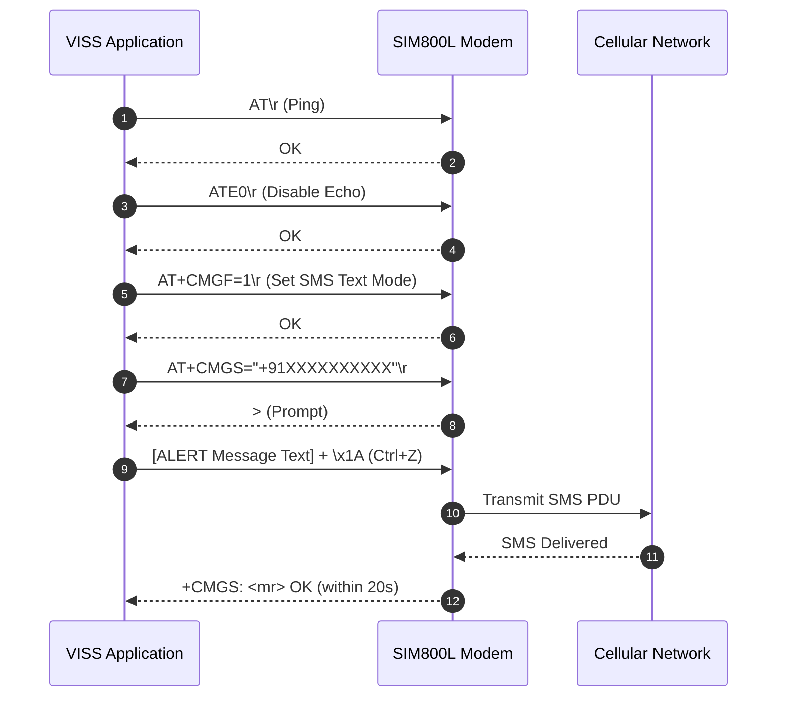
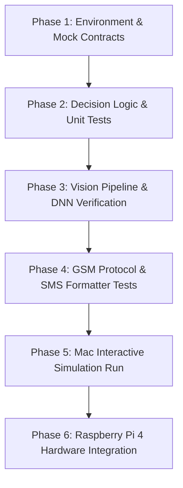

# Project Reference Review: Visual Impairment Support System (VISS)

> **Document Status**: Complete Reference Analysis & Architecture Specification  
> **Primary Reference**: B.Tech Project-C Report (*Black Book*) — Pillai College of Engineering, University of Mumbai (Authors: Shivam Bhakare, Vinanti Bhoir, Shravani Margaj, Reva Patil; Supervisor: Prof. Sweta Waghmare)  
> **Supporting Reference**: Research Paper (*Visual Impairment Support*, IJERT Vol. 15 Issue 03, March 2026) & Appendix Exhibition Materials (Avishkar Research Convention 2025–2026)  
> **Target Platforms**: Development on **macOS (MacBook Air M2)** $\rightarrow$ Deployment on **Raspberry Pi 4 (Raspberry Pi OS)**

---

## Executive Summary & Reading Guide

This document presents a comprehensive, objective technical review of the reference materials provided for the **Visual Impairment Support System (VISS)**. 

To maintain strict engineering rigor, every technical detail throughout this review is classified into one of three distinct categories:
- **[Explicitly Stated]**: Verified directly from the Black Book text, schematic diagrams, code listings, or research paper.
- **[Technical Recommendation]**: Best-practice engineering advice to ensure software reliability, cross-platform portability, hardware safety, and maintainability.
- **[Unknown / Requires Verification]**: Underspecified items, physical ambiguities, or conflicting specifications that must be validated before hardware deployment.

---

## 1. Project Objectives and Required Features

### Stated Objectives
- **Assistive Mobility Aid [Explicitly Stated]**: Provide a wearable assistive device (mounted on a cap or glasses frame) that enables visually impaired users to navigate indoor and outdoor spaces with greater safety and independence.
- **Multi-Modal Threat Awareness [Explicitly Stated]**: Combine physical distance measurement (ultrasonic ranging) and visual perception (computer vision) to identify hazards and obstacles in the user's path.
- **Dual-Tier Feedback [Explicitly Stated]**: Deliver immediate warning cues through audio (beeps and spoken/sound warnings) and haptic vibration.
- **Emergency SOS Transmission [Explicitly Stated]**: Provide a one-touch physical push button that sends an automated distress SMS to a pre-configured guardian phone number containing the user's detected location and contextual hazard information.
- **Low-Cost & Edge-Processed [Explicitly Stated]**: Run entirely on an embedded edge controller (Raspberry Pi 4) without requiring external cloud computing infrastructure for real-time sensing.

### Document Conflicts & Ambiguities Identified
1. **Offline Capability vs. Internet Geolocation [Conflict]**:
   - *Report Narrative (Ch 1.2, Ch 3.1.5)* states: The system operates completely offline without internet connectivity, making it reliable in rural areas.
   - *Report Code (Ch 5.3.1, line GEO_URL)* states: Emergency location fetching calls `http://ip-api.com/json` via the Python `requests` library over an active internet connection.
   - *Impact*: In the code as written, if the device lacks Wi-Fi or cellular data, `fetch_location()` times out and the SMS is transmitted with `"Loc: unavailable"`.
2. **Haptic Feedback (Vibration Motor) [Conflict]**:
   - *Report Narrative (Abstract, Ch 1.3, Ch 3.1.4, Ch 5.1, Ch 6.9)* states: A vibration motor provides haptic alerts for proximity warnings.
   - *Hardware BOM (Table 3.2), Pin Table (Table 5.1), and Code (Ch 5.3.1)*: No vibration motor GPIO pin or control logic exists anywhere in the pin assignments or code.

---

## 2. Hardware Components & Stated Specifications

| Component | Stated Specification / Model | Source Document Reference | Status / Engineering Notes |
| :--- | :--- | :--- | :--- |
| **Central Processor** | Raspberry Pi 4 Model B (8 GB RAM stated) | Black Book Table 3.2, Sec 3.2.1 | **[Explicitly Stated]** Runs 64-bit Raspberry Pi OS (Raspbian). |
| **Obstacle Sensor** | HC-SR04 Ultrasonic Sensor (2 cm – 400 cm range) | Black Book Sec 3.2.2, Table 3.2 | **[Explicitly Stated]** Stated operating range: 2 cm to 4 m. |
| **Vision Sensor** | Raspberry Pi Camera Module V2.1 (8 MP) | Black Book Sec 3.2.3, Table 3.2 | **[Explicitly Stated]** 15-pin CSI ribbon cable interface; up to 1080p video feed. |
| **Cellular Modem** | SIM800L GSM/GPRS Module | Black Book Sec 3.2.4, Table 3.2 | **[Explicitly Stated]** Quad-band (850/900/1800/1900 MHz); 3.7V–4.2V operating voltage; UART interface at 9600 baud. |
| **Power Supply (Modem)** | 3.7V Lithium-Ion Cell (18650 form-factor pictured) | Black Book Sec 3.2.5, Table 3.2 | **[Explicitly Stated]** Dedicated power supply for SIM800L to handle 2A transmission burst currents. |
| **Audio Alert Unit** | Piezo Buzzer | Black Book Sec 3.2.6, Table 3.2 | **[Explicitly Stated]** Digital active/passive buzzer for proximity beeps. |
| **Emergency Input** | Momentary Push Button | Black Book Sec 3.2.7, Table 3.2 | **[Explicitly Stated]** Tactile button for SOS trigger. (BOM Table 3.2 lists Qty: 2, but Pin Table 5.1 and Code use Qty: 1). |
| **Vibration Motor** | Unspecified DC Coin/ERM Vibration Motor | Mentioned in Ch 3, Ch 4, Ch 6 | **[Unknown / Requires Verification]** Mentioned in text only; missing from BOM Table 3.2, Pin Table 5.1, and Code. |
| **Audio Playback** | 3.5 mm Audio Jack / Connected Earphones vs. DFPlayer Mini | Conflicting across documents | **[Conflict]** Black Book code uses Raspberry Pi onboard 3.5 mm audio jack via `aplay`. Research paper describes a separate DFPlayer Mini module driving an 8 Ω speaker. |
| **Power Regulation** | DC-DC Step-Down Buck Converter (5V to 4.0V) | Black Book Sec 5.1; Paper Sec IV.F | **[Explicitly Stated in Paper]** Buck converter with 1000 µF and 100 nF filtering capacitors. |

---

## 3. Circuit Diagrams, GPIO Assignments & Wiring Details

### Stated Pin Connections (Black Book Table 5.1 & Circuit Diagram Fig 4.2)

| Component | Component Pin | Connected To | Physical Pin | BCM GPIO | Electrical Notes / Conflict Flag |
| :--- | :--- | :--- | :--- | :--- | :--- |
| **HC-SR04** | VCC | 3.3V Power | Pin 1 | — | **[Warning / Verification Needed]** Standard HC-SR04 requires 5V. Connecting to 3.3V may cause false readings unless HC-SR04P is used. |
| **HC-SR04** | GND | Ground | Pin 6 | — | Shared system ground. |
| **HC-SR04** | TRIG | GPIO24 | Pin 18 | GPIO24 | **[CRITICAL PIN CONFLICT WITH CODE]** Table 5.1 states TRIG = GPIO24. |
| **HC-SR04** | ECHO | GPIO23 | Pin 16 | GPIO23 | **[CRITICAL PIN CONFLICT WITH CODE]** Table 5.1 states ECHO = GPIO23 (with voltage divider). |
| **Buzzer** | Anode (+) | GPIO18 | Pin 12 | GPIO18 | Active buzzer output. |
| **Buzzer** | Cathode (−) | Ground | Pin 14 | — | Connected to Pi Ground. |
| **Push Button** | Terminal 1 | GPIO17 | Pin 11 | GPIO17 | Active-low input with internal software pull-up (`pull_up=True`). |
| **Push Button** | Terminal 2 | Ground | Pin 6 / Pin 9 | — | Ground reference. |
| **SIM800L** | RXD | Pi TXD | Pin 8 | GPIO14 | Serial communication (Raspberry Pi transmits to SIM800L). |
| **SIM800L** | TXD | Pi RXD | Pin 10 | GPIO15 | Serial communication (SIM800L transmits to Raspberry Pi). |
| **SIM800L** | GND | Common GND | Pin 6 | — | Must share common ground with Pi. |
| **SIM800L** | VCC | Li-ion (+) | External | — | 3.7V–4.2V external battery positive terminal. |
| **Li-ion Battery**| Negative (−) | Common GND | Pin 6 | — | Common ground return path. |
| **Pi Camera** | 15-pin Ribbon | CSI Port | Dedicated | — | Ribbon cable to CSI connector. |

### Critical Hardware Discrepancies & Safety Warnings

> [!CAUTION]
> **1. Ultrasonic GPIO Pin Inversion (Code vs. Schematic)**:
> - **Table 5.1 & Schematic (Fig 4.2)**: `TRIG = GPIO24`, `ECHO = GPIO23`.
> - **Code Listing (Ch 5.3.1, Page 37)**: `DistanceSensor(echo=24, trigger=23)`.
> - **Result**: The code reverses the Trigger and Echo pins! If you wire the hardware strictly according to Table 5.1 and run the provided script, the sensor will never trigger and distance readings will fail.
> - **Technical Recommendation**: Make pin assignments fully configurable via environment variables or a configuration file (`config.py`) rather than hardcoding them.

> [!WARNING]
> **2. HC-SR04 5V Echo vs. Raspberry Pi 3.3V Logic**:
> - If an HC-SR04 is powered with 5V, its `ECHO` output pin transmits a 5V signal. Connecting 5V directly to a Raspberry Pi GPIO pin (rated for 3.3V maximum) can permanently damage the processor's GPIO bank.
> - Table 5.1 states: `"ECHO: GPIO23 (via voltage divider)"`. A voltage divider (e.g., 1 kΩ in series, 2 kΩ to ground) or a logic level shifter is required if using standard 5V HC-SR04.

> [!NOTE]
> **3. Research Paper Pin Conflict (Table I)**:
> - The research paper lists: `Buzzer: GPIO18`, `DFPlayer RX: GPIO20`, `DFPlayer TX: GPIO16`, `PWKEY: GPIO26`.
> - The Black Book code contains **zero** mentions of GPIO16, GPIO20, or GPIO26, and does not include any DFPlayer or PWKEY driver. The Black Book is our primary reference.

---

## 4. Software Architecture and Algorithms

### Stated Pipeline (Narrative vs. Code)
The project documentation describes a 5-stage conceptual pipeline:
1. **Data Acquisition**: Continuous polling of ultrasonic distance and camera video frames.
2. **Preprocessing**: Image resizing and normalization for neural network input.
3. **Object Detection**: Frame-by-frame inference to detect obstacles and categorize entities.
4. **Decision Logic**: Multi-tiered rules determining whether to trigger auditory warnings, beeps, or distress messages.
5. **Feedback Delivery**: Execution of alert mechanisms (buzzer, audio playback, SMS transmission).

### Actual Code Implementation Structure (Chapter 5.3.1)
The code in the Black Book is written as a multi-threaded monolithic script:
- **Shared State (`Shared` class)**: Uses a `threading.Lock` to synchronize:
  - `latest_distance_m`: Current distance in meters from the ultrasonic sensor.
  - `last_label`: Most recent detected target object label.
  - `last_target_seen_ts`: Timestamp when a target object was last identified.
  - `geo_cache` & `geo_cache_ts`: Cached geolocation data.
  - `running`: Boolean flag controlling thread lifecycle.
- **Sensor & Buzzer Thread (`sensor_thread_fn`)**:
  - Runs as a daemon thread in an infinite loop (~83 Hz tick, `sleep(0.012)`).
  - Samples distance via `gpiozero.DistanceSensor(echo=24, trigger=23, max_distance=4.0, queue_len=5)`.
  - Determines buzzer beep cadences based on distance.
- **Main Vision Loop**:
  - Captures video using `picamera2.Picamera2` at 640×480 resolution.
  - Resizes to 320×240 for MobileNet-SSD inference.
  - Performs forward pass through OpenCV DNN module.
  - Evaluates detections, filters by confidence (`CONF_THRESH = 0.5`) and target classes.
  - Spawns asynchronous audio playback via `play_sound()`.
  - Displays bounding boxes, distance, and FPS using `cv2.imshow()`.
- **Button & Emergency Handler**:
  - Configures `gpiozero.Button(17, pull_up=True, bounce_time=0.05)`.
  - On press event, spawns a background thread running `on_button_press()`, which calls `compose_sms()` and sends AT commands over UART.

---

## 5. Intended Object-Detection Method

### Model & Framework Specifications

| Parameter | Report Text / Paper Stated | Actual Code Implemented | Final Technical Assessment |
| :--- | :--- | :--- | :--- |
| **Framework** | "OpenCV Haar-Cascade Classifiers" | OpenCV DNN Caffe (`cv2.dnn.readNetFromCaffe`) | **[Conflict]** The narrative references Haar Cascades, but the executable code strictly runs **MobileNet-SSD (Caffe)**. |
| **Model Weights** | Not specified in narrative | `MobileNetSSD_deploy.caffemodel` | **[Explicitly Stated in Code]** Standard Caffe pre-trained weights. |
| **Model Prototxt** | Not specified in narrative | `MobileNetSSD_deploy.prototxt` | **[Explicitly Stated in Code]** Network architecture definition. |
| **Dataset Classes** | Mentioned "person, vehicle, wall" | Pascal VOC 20-class taxonomy | **[Explicitly Stated in Code]** 20 classes (`aeroplane`, `bicycle`, `bird`, `boat`, `bottle`, `bus`, `car`, `cat`, `chair`, `cow`, `diningtable`, `dog`, `horse`, `motorbike`, `person`, `pottedplant`, `sheep`, `sofa`, `train`, `tvmonitor`). |
| **Target Classes** | Any obstacle | `{"person", "dog", "cat", "car"}` | **[Explicitly Stated in Code]** Filtered strictly to these four target entities. |
| **Inference Input** | 1080p stream | Resized to 320×240, blobbed at 300×300 | **[Explicitly Stated in Code]** Scale: `0.007843` (1/127.5), Mean: `(127.5, 127.5, 127.5)`. |
| **Confidence Threshold** | Not stated in narrative | `CONF_THRESH = 0.5` (50%) | **[Explicitly Stated in Code]** Bounding boxes below 0.5 confidence are discarded. |

---

## 6. Obstacle-Detection Threshold and Alert Behaviour

### Distance Thresholds
The code implements three distinct proximity bands:
1. **Critical Zone (`< 0.40 m` / 40 cm)**: `CONTINUOUS` — Buzzer turns ON and stays continuously active.
2. **Warning Zone (`0.40 m` to `0.80 m` / 40 cm – 80 cm)**: `FAST_BEEP` — Buzzer pulses rapidly at **80 ms ON / 80 ms OFF**.
3. **Caution Zone (`0.80 m` to `1.50 m` / 80 cm – 150 cm)**: `SLOW_BEEP` — Buzzer pulses slowly at **150 ms ON / 250 ms OFF**.
4. **Safe Zone (`>= 1.50 m` / 150 cm)**: Buzzer remains completely OFF.

### Critical Behavioral Discovery: The Vision "Arming" Gate

> [!IMPORTANT]
> In the Black Book code (Ch 5.3.1, lines 38 & 45), the buzzer alert logic contains a critical gate:
> ```python
> armed = (time.time() - shared.last_target_seen_ts) <= ARM_WINDOW
> desired_pattern = pick_beep_pattern(dist_m) if armed else None
> ```
> where `ARM_WINDOW = 1.0` second.
> 
> **What this means in practice:**
> The buzzer **will only sound if the camera has detected a target object (`person`, `dog`, `cat`, or `car`) within the last 1.0 second**. If a visually impaired user walks toward a wall, closed door, pillar, or tree, the camera will *not* detect a person/animal/car, `armed` will be `False`, and the buzzer **will remain completely silent**, even if the user is 10 cm away from a collision!
>
> **Technical Recommendation**:
> Decouple proximity alert from vision arming. A safety mobility aid must alert on *any* physical obstacle via ultrasonic ranging, while using computer vision to provide *contextual* identification. We will structure the architecture to allow configuring whether the buzzer is independent or vision-gated.

---

## 7. Audio and Emergency-Button Behaviour

### Audio Notification Behaviour
- **Report Description vs. Implemented Reality**:
  - *Report Narrative*: Claims dynamic text-to-speech (TTS) generating spoken sentences like *"Person ahead"* or *"Obstacle in front"* through the headphone jack.
  - *Actual Code*: Does not contain any TTS library (such as `espeak`, `pyttsx3`, or Piper). Instead, it plays two static audio files via the Linux ALSA `aplay` command:
    - **`a.wav` (Animal Alert)**: Triggered if any detected object in the frame is a `"dog"` or `"cat"`.
    - **`h.wav` (Human/Vehicle Alert)**: Triggered if any detected object in the frame is a `"person"` or `"car"`.
  - Playback is asynchronous: Each audio call spawns a daemon thread executing `subprocess.run(["aplay", path], stdout=DEVNULL, stderr=DEVNULL)` to prevent blocking the video stream.

### Emergency Button Press Sequence
When the tactile push button on GPIO17 is pressed:
1. `gpiozero.Button` detects the low state (active-low with pull-up resistor and 50 ms debounce).
2. Spawns a background thread running `on_button_press()`.
3. Calls `compose_sms(shared)`:
   - Reads current `last_label` (defaults to `"N/A"` if none seen).
   - Reads current `latest_distance_m` (formatted as `"{dist:.2f} m"` or `"unknown"`).
   - Attempts location lookup via `fetch_location(shared)`.
4. Assembles the SMS payload:
   ```text
   [ALERT]
   Detected: person
   Range: 0.65 m
   Loc: Mumbai, Maharashtra, India
   https://maps.google.com/?q=19.074800,72.885600
   ```
   *(If location lookup fails, the fallback message is:)*
   ```text
   [ALERT]
   Detected: person
   Range: 0.65 m
   Loc: unavailable
   ```
5. Calls `gsm_send_sms(PHONE_NUMBER, text)` over UART.

---

## 8. GSM Communication Requirements

### UART Interface Details
- **Port**: `/dev/ttyS0` (Raspberry Pi hardware mini-UART mapped to GPIO14/15).
- **Baud Rate**: `9600` baud, 8 data bits, no parity, 1 stop bit.
- **Timeout**: 2.0 seconds read timeout.

### AT Command Protocol Sequence



### Unused Email Alert Routine
The code listing contains a complete SMTP email function (`send_email_alert`) configured with:
- SMTP Server: `smtp.gmail.com:587` (TLS)
- Stored Sender: `shivambhakare2@gmail.com`
- App Password: Hardcoded in plaintext
- Receiver: `patilrevarajesh@gmail.com`
- **Status in Execution**: This function is defined in the script but **never called** anywhere in the main execution or button handler.

---

## 9. Testing Requirements and Expected Results

### Benchmark Metrics (Black Book Table 6.1 & Research Paper Table II)

| Environment Tested | Distance Accuracy | Vision Accuracy | System Latency | Document Remarks |
| :--- | :--- | :--- | :--- | :--- |
| **Indoor Corridor** | 98% | Successful (High) | 1.5 s | Optimal conditions; reliable ranging and detection. |
| **Outdoor Walkway** | 96% | Successful (High) | 2.0 s | Ambient daylight; stable performance. |
| **Classroom** | 97% | Successful (High) | 1.6 s | Stationary objects and students detected reliably. |
| **Low-Light Room** | 85% | Reduced Accuracy | 1.8 s | Ultrasonic remains functional; camera vision degrades. |
| **Crowded Area** | 90% | Medium Accuracy | 2.2 s | Overlapping objects challenge single-frame bounding boxes. |

### Operational Performance Specifications
- **Emergency SMS Delivery Time**: 3 to 7 seconds in Black Book; 8 to 10 seconds in Research Paper.
- **Continuous Battery Endurance**: 3 to 4 hours of active operation on single charge.
- **Audio Proximity Response**: Instantaneous acoustic response (< 100 ms) via hardware thread.

---

## 10. Stated Limitations

1. **Environmental Illumination Dependency [Explicitly Stated]**: The standard camera module lacks infrared sensitivity, causing classification accuracy to drop in dim environments (< 85%).
2. **Network Dependency for Geolocation [Explicitly Stated in Code Analysis]**: While SMS relies on cellular GSM towers, the implemented location mechanism requires active internet IP resolution.
3. **Single Forward-Facing Field of View [Explicitly Stated]**: The ultrasonic sensor and camera cover only a forward cone (~15°–30° for ultrasonic; ~62° horizontal for Pi Camera V2), leaving peripheral and ground-drop hazards (stairs, curbs) undetected.
4. **Thermal and Power Consumption [Explicitly Stated]**: Running continuous OpenCV DNN inference on Raspberry Pi 4 CPU generates heat and exhausts portable battery packs within 3–4 hours.
5. **Acoustic Noise Interference [Explicitly Stated]**: In loud traffic environments, piezo buzzer beeps may be masked, necessitating direct earphone audio or tactile vibration.

---

## 11. Recommended Modular Python Architecture

To enable rapid local development and thorough automated testing on your **MacBook Air M2** without hardware, followed by a clean deployment to the **Raspberry Pi 4**, the software must be structured into independent, loosely coupled layers using **Dependency Injection** and **Hardware Abstraction Interfaces**.

```
viss_project/
├── config/
│   ├── __init__.py
│   ├── settings.py              # Central settings, thresholds, pin definitions, model paths
├── core/
│   ├── __init__.py
│   ├── models.py                # Data classes (DetectionResult, DistanceReading, SystemState)
│   ├── engine.py                # Core decision logic & alert coordinator
├── hardware/
│   ├── __init__.py
│   ├── base.py                  # Abstract Base Classes (Interfaces) for all hardware
│   ├── camera/
│   │   ├── base_camera.py       # Camera interface
│   │   ├── picam2_camera.py     # Raspberry Pi Picamera2 driver (Pi 4 only)
│   │   ├── opencv_camera.py     # Mac webcam driver (M2 development)
│   │   └── mock_camera.py       # Static image/video simulator for unit tests
│   ├── distance/
│   │   ├── base_distance.py     # Ultrasonic sensor interface
│   │   ├── gpio_distance.py     # gpiozero DistanceSensor driver (Pi 4 only)
│   │   └── mock_distance.py     # Simulated distance generator for tests/Mac
│   ├── alert/
│   │   ├── base_buzzer.py       # Buzzer interface
│   │   ├── gpio_buzzer.py       # gpiozero Buzzer driver (Pi 4 only)
│   │   ├── console_buzzer.py    # Log/visual buzzer for Mac terminal
│   │   └── sound_player.py      # Cross-platform sound player (aplay on Pi / afplay on Mac)
│   ├── gsm/
│   │   ├── base_gsm.py          # Modem interface
│   │   ├── serial_gsm.py        # Real pySerial SIM800L driver (Pi 4 only)
│   │   └── mock_gsm.py          # Mock GSM modem verifying AT sequences
│   └── location/
│       ├── base_location.py     # Geolocation interface
│       ├── ip_location.py       # IP geolocation provider
│       └── mock_location.py     # Deterministic location for tests
├── vision/
│   ├── __init__.py
│   ├── detector.py              # MobileNet-SSD detector wrapper (OpenCV DNN)
│   └── weights/                 # Model files (.prototxt and .caffemodel)
├── tests/
│   ├── unit/                    # Fast isolated component tests
│   │   ├── test_decision_logic.py
│   │   ├── test_distance_patterns.py
│   │   └── test_sms_composer.py
│   ├── integration/             # Multi-module pipeline tests with mocks
│   │   └── test_emergency_pipeline.py
│   └── fixtures/                # Test assets (sample images, simulated audio files)
└── main.py                      # Application bootstrap & dependency wiring
```

### Why This Architecture Works for MacBook Air M2 $\rightarrow$ Raspberry Pi 4

1. **Zero Hardware Lock-In on macOS**:
   - `picamera2` and `gpiozero` do not compile or run on macOS. With the abstract interfaces above, your app detects the platform:
     - On macOS: Loads `opencv_camera` (using your MacBook's FaceTime HD camera), `mock_distance` (generating synthetic distances or keyboard-controlled slider), and `sound_player` (calling native macOS `afplay`).
     - On Raspberry Pi: Loads `picam2_camera`, `gpio_distance`, `gpio_buzzer`, `serial_gsm`, and `aplay`.
2. **MacBook Apple Silicon Acceleration**:
   - OpenCV DNN on macOS M2 runs natively on ARM64 using optimized Apple Silicon vector extensions, allowing ultra-fast testing and debugging of the MobileNet-SSD pipeline.
3. **Decoupled Decision Logic**:
   - The decision engine (`engine.py`) receives clean dataclasses (`DistanceReading(distance_m=0.35)`, `Detection(label="person", confidence=0.88)`). It has zero knowledge of GPIO pins or hardware registers, allowing 100% test coverage using plain pytest.

---

## 12. Test-First Development Plan

A phased, test-driven roadmap ensures every feature is mathematically and behaviorally verified before touching physical wires:



### Phase 1: Environment Setup & Core Interfaces
- Set up a clean Python virtual environment.
- Create base abstract classes (`ABC`) defining contracts for `BaseCamera`, `BaseDistanceSensor`, `BaseBuzzer`, `BaseGSM`, and `BaseLocation`.
- Create mock implementations of all interfaces.

### Phase 2: Decision Logic & Unit Tests (Test-Driven)
- Write unit tests for `pick_beep_pattern(dist_m)`:
  - Test distance `< 0.40m` $\rightarrow$ verifies `CONTINUOUS`.
  - Test distance `0.40m - 0.80m` $\rightarrow$ verifies `FAST_BEEP`.
  - Test distance `0.80m - 1.50m` $\rightarrow$ verifies `SLOW_BEEP`.
  - Test distance `>= 1.50m` $\rightarrow$ verifies `None`.
- Write unit tests for Vision Arming:
  - Verify behavior when target is present vs. absent within the `ARM_WINDOW`.
  - Add option to configure whether distance beeps require visual arming.
- Write unit tests for SMS message composition and fallback strings when geolocation is unavailable.

### Phase 3: Vision Pipeline on macOS
- Implement `detector.py` using OpenCV DNN.
- Download `MobileNetSSD_deploy.prototxt` and `MobileNetSSD_deploy.caffemodel`.
- Write tests using static fixture images (e.g., an image of a person, an image of a dog, and an image of an empty room).
- Verify bounding box extraction, class filtering for `TARGET_CLASSES`, and confidence scoring.

### Phase 4: GSM AT Command Parser & State Machine
- Write unit tests simulating the SIM800L serial dialog (`AT`, `ATE0`, `AT+CMGF=1`, `AT+CMGS=...`, Ctrl+Z, `OK`).
- Verify error handling on UART timeout, SIM not inserted, or missing network registration.

### Phase 5: Mac Interactive Simulation
- Run the full application on your MacBook Air M2:
  - Video feed: FaceTime HD Camera or recorded video loop.
  - Audio: Native macOS `afplay`.
  - Ultrasonic sensor: Simulated via keyboard controls (e.g., up/down arrow keys to change obstacle distance) or simulated walk sequences.
  - Emergency button: Simulated via spacebar press.
  - SMS: Mock logger printing the composed SMS to the console.

### Phase 6: Hardware Deployment on Raspberry Pi 4
- Flash Raspberry Pi OS (64-bit Bullseye or Bookworm).
- Verify GPIO assignments, level shifters on ultrasonic ECHO, and dedicated 3.7V power for SIM800L.
- Wire components and toggle configuration to use hardware drivers (`picam2_camera`, `gpio_distance`, etc.).
- Validate performance against Table 6.1 benchmarks.
